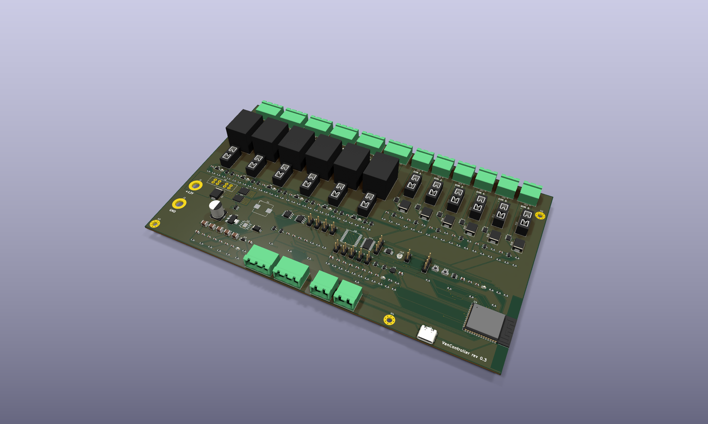

# VanController

A 12 V campervan controller board: ESP32-S3 with 6 fused relays, 6 fused PWM dimmers, CAN, RS485, GPS, an accelerometer and 2 water-level inputs, plus a 3D-printable enclosure. Designed in KiCad 10.

| | |
|---|---|
| **Revision** | 0.3 |
| **Status** | Design complete (ERC and DRC clean). Prototype order with PCBWay under engineering review since 2026-10-06; see [docs/ORDER_LOG.md](docs/ORDER_LOG.md). Not yet verified on hardware. |
| **Board** | 230 × 135 mm, 4 layers (In1 = GND plane, In2 = +12 V plane), 1.6 mm, 1 oz copper, ENIG |
| **Enclosure** | 251 × 142 × 35 mm two-part print with mounting ears ([enclosure/](enclosure/)) |

## Features

- **Power:** 12 V input on M5 studs. 30 A ATO main fuse, bidirectional load-dump TVS, LM74700-Q1 ideal-diode reverse-polarity protection with 2 × CSD18540Q5B, TPS54360 buck to 5 V, AMS1117 to 3.3 V. Input voltage sensing.
- **6 relay outputs:** Omron G5LE 10 A, each with its own mini blade fuse, COM/NO/NC terminals (COM = fused +12 V), indicator LED and fuse-blown sensing.
- **6 dimmer outputs:** 60 V logic-level MOSFETs (low side, PWM), 5 A mini blade fuse each, freewheel diode, fuse-blown sensing.
- **Comms:** CAN (TJA1051T/3) and RS485 (THVD1450), with jumper-selectable termination and fail-safe bias.
- **Sensors:** u-blox MAX-M10S GPS (u.FL active antenna), LIS3DH accelerometer, ADS1115 16-bit ADC with 2 water-level inputs (each jumper-selectable for resistive, 4-20 mA or 0-5 V senders).
- **MCU:** ESP32-S3-WROOM-1-N16 with native USB-C, BOOT/RESET buttons and a UART debug header. Wi-Fi/BLE antenna at the board edge, with no copper under it.
- **Terminals:** all 12 outputs along one edge on Phoenix MSTBA 5.08 mm pluggable headers.

## Documents

| Document | Contents |
|---|---|
| [DESIGN_SPEC.md](DESIGN_SPEC.md) | Design decisions, **GPIO map**, I2C addresses, terminal pinouts, PCB notes, open design checks, **firmware notes** |
| [docs/ORDER_LOG.md](docs/ORDER_LOG.md) | Manufacturing record: PCBWay quote and cart items, decisions (1 oz copper, ENIG, self-fitted through-hole parts), engineering Q&A, open items |
| [docs/VanController_schematic.pdf](docs/VanController_schematic.pdf) | Full schematic (19 pages) |
| [docs/VanController_assembly_top.pdf](docs/VanController_assembly_top.pdf) | Top-side assembly drawing with reference designators |
| [docs/](docs/) | Board and placement images, 3D renders |

## Repository layout

| Path | Contents |
|---|---|
| `VanController.kicad_pro`, `*.kicad_sch`, `VanController.kicad_pcb` | KiCad 10 project. Hierarchical schematic: root → Power, MCU, Relays (6 × `relay_channel`), Dimmers (6 × `dimmer_channel`), Comms, Sensors |
| `fab/` | Gerbers + drill (`gerbers/`, `VanController_gerbers.zip`), BOM, pick-and-place, board STEP model |
| `manufacturing/VanController_rev0.3_PCBWay/` | The order package sent to PCBWay: Gerbers, BOM with manufacturer part numbers (xlsx), centroid file, order notes, drawings, 3D model, optional enclosure print files |
| `enclosure/` | Fusion 360 enclosure script, print-ready STLs, assembly STEP with the PCB (run the script to recreate the Fusion design) |
| `tools/` | Python scripts that generated and finish the project (see below) |

## Ordering and building

1. **Order:** upload the files from `manufacturing/VanController_rev0.3_PCBWay/` (read `00_READ_ME_ORDER_NOTES.txt`), or rebuild the package with `python tools/make_order_package.py`. Settings used: 4 layers, 1.6 mm, **1 oz** copper (2 oz is not manufacturable with this design's 0.15 mm fine-pitch spacing), ENIG, SMD-only assembly.
2. **Through-hole parts** are fitted by hand: relays K1-K6, terminal headers, fuse holders F1-F13 and pin headers (47 per board). The relay, F1 and output terminal joints sit on large copper areas, so use a 60-80 W iron.
3. **Not fitted by the assembler:** blade fuses (size each to its load), jumper shunts (choose per [DESIGN_SPEC.md §4](DESIGN_SPEC.md#4-terminals)) and the M5 stud bolts for J1/J2.
4. **Enclosure:** print `enclosure/VanController_base.stl` and `VanController_lid.stl` in PETG or ASA (not PLA). Hardware: 8 × M3 heat-set inserts, 4 × M3×8 (lid), 4 × M3×6 (PCB), 2 × M16 cable glands, 1 × SMA bulkhead to u.FL pigtail.
5. **First power-up:** use a current-limited bench supply, check +5 V and +3V3, then fit fuses one output at a time. See [DESIGN_SPEC.md §7](DESIGN_SPEC.md#7-design-checks-and-cautions) for the thermal and load checks.

## How the design was generated

The schematic and board were generated by scripts, then routed and hand-fixed. **From now on, edit the design in KiCad.** The board contains hand fixes (around U9) that no script reproduces, so do not regenerate it.

| Script | Purpose | Overwrites |
|---|---|---|
| `tools/gen_schematic.py` | Builds every schematic sheet from the circuit tables in the script | all `.kicad_sch` |
| `tools/gen_pcb.py` (KiCad Python) | Builds the board from the netlist: footprints, placement, high-current copper, planes, plane fan-out vias | `VanController.kicad_pcb` |
| `tools/netclasses.py` | Writes net classes and design rules into `.kicad_pro` | net settings |
| Freerouting 1.9.0 | Autoroutes the exported DSN: `java -jar freerouting-1.9.0.jar -de vc.dsn -do vc.ses -mp 40 -mt 1` | — |
| `tools/finish_pcb.py` (KiCad Python) | Imports routes, adds outer GND pours, fills zones, tidies silkscreen | the board given |
| `tools/fix_pcb.py` (KiCad Python) | Fixes via drills, removes dangling router tails, refills zones | the board given |
| `tools/patch_pcb.py` (KiCad Python) | Hand fixes: MOSFET gate link on B.Cu, vias for stranded plane pads | the board given |
| `tools/make_fab.py` | Gerbers, drill, BOM, pick-and-place, STEP, PDFs | `fab/`, `docs/` |
| `tools/make_order_package.py` | Builds the PCBWay order package (xlsx BOM with MPNs, board-origin centroid, notes) | `manufacturing/` |
| `enclosure/VanControllerEnclosure/VanControllerEnclosure.py` | Fusion 360 script: builds base + lid, imports the PCB, exports STL/STEP/f3d into the `enclosure/` folder next to it | `enclosure/` outputs |

**Tool notes:**
- KiCad Python is `C:\Program Files\KiCad\10.0\bin\python.exe`.
- Freerouting is not in the repo: download `freerouting-1.9.0.jar` from the [Freerouting releases](https://github.com/freerouting/freerouting/releases) into `tools/freerouting/`. Use 1.9.0 with `-mt 1`: version 2.x ignores the pass limit from the command line, and multithreaded optimisation creates clearance errors.
- Before exporting the DSN, set the inner layers to power-plane type (`gen_pcb.py` does this), or Freerouting routes signals on them and splits the planes.

## Lessons learned (rev 0.3)

- Fan out SMD pads on plane nets (stub + via) before autorouting: unrouted connections fell from 499 to 5.
- Check that autorouted tracks don't cut high-current copper areas: an early route split one input MOSFET's sources off the input.
- 2 oz outer copper needs ≥ 6.5-8 mil spacing. Fine-pitch ICs at 0.15 mm force 1 oz.
- PCBWay wants ≥ 0.19 mm between pads for solder-mask dams. Below that, the mask is opened across the IC.
- KiCad Python: `PCB_VIA.GetWidth()` without a layer argument raises an invisible assert dialog that hangs the script. Use `GetWidth(pcbnew.F_Cu)`.

## Revision history

| Rev | Date | Changes |
|---|---|---|
| 0.1 | 2026-10-05 | Spec, GPIO map, hierarchical sheet skeleton |
| 0.2 | 2026-10-05 | Full schematic (ERC clean); first 169 × 135 mm placement |
| 0.3 | 2026-10-05/06 | 230 × 135 mm rectangular layout with all outputs on one edge; plane fan-out; routed (DRC clean); TCA9535 address changed to 0x21; enclosure; PCBWay order package and order submitted |

## Licence

Copyright (c) 2026 Camperlux. **Free for non-commercial use.** The hardware design, manufacturing files and documentation are under [CC BY-NC-SA 4.0](LICENSE-docs.txt), and the scripts are under the [PolyForm Noncommercial License 1.0.0](LICENSE.md). Commercial use, including selling boards, kits or products based on this design, needs a licence from Camperlux. See [NOTICE.md](NOTICE.md) for details and third-party parts.
